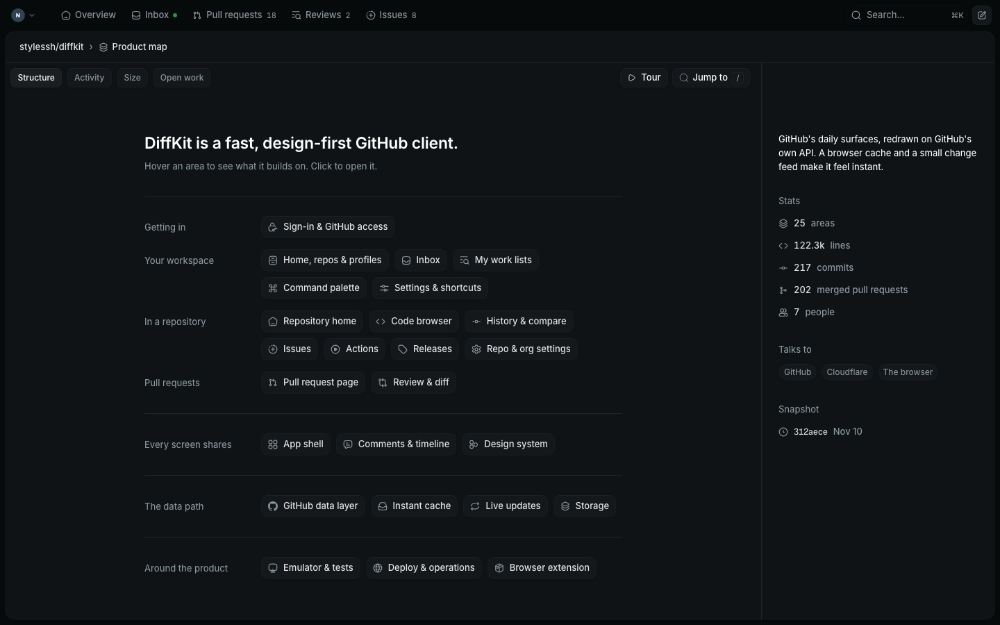
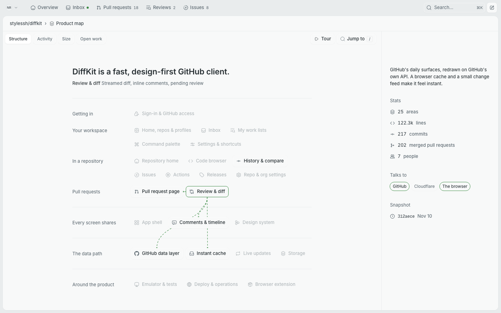
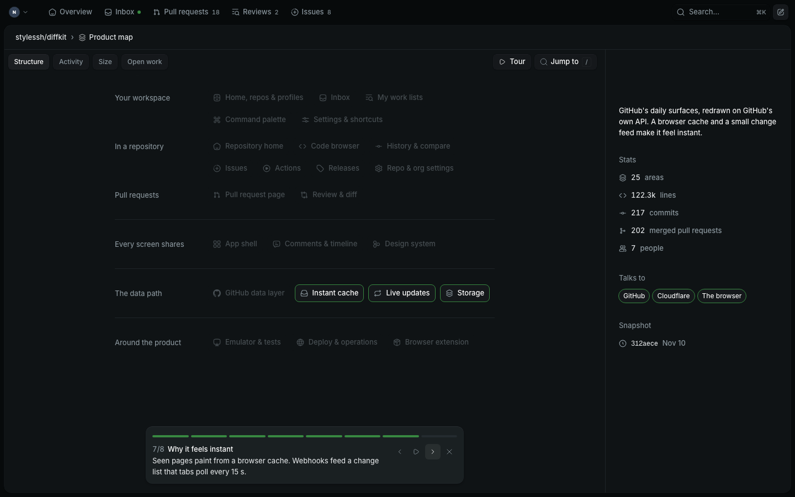
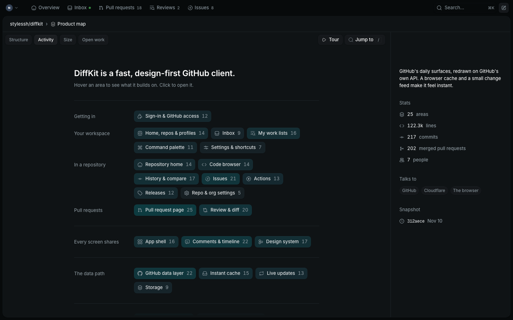
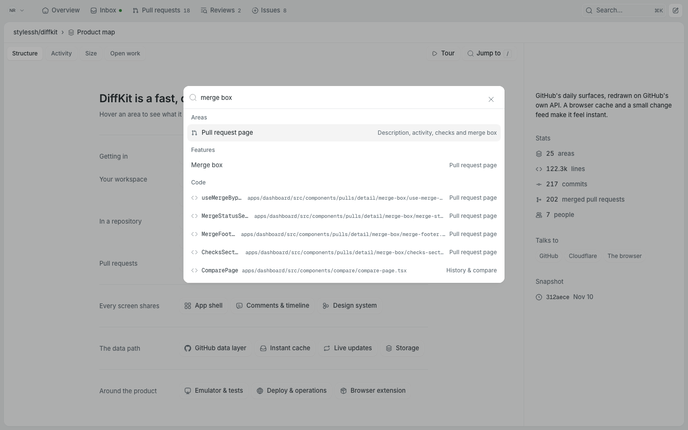
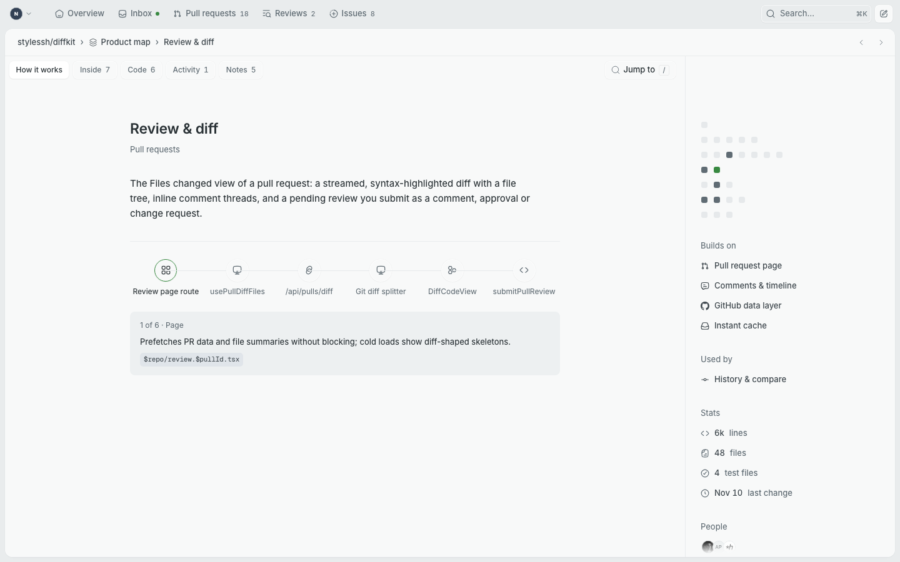
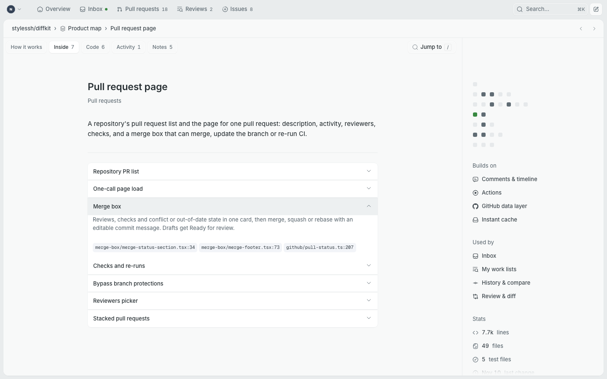
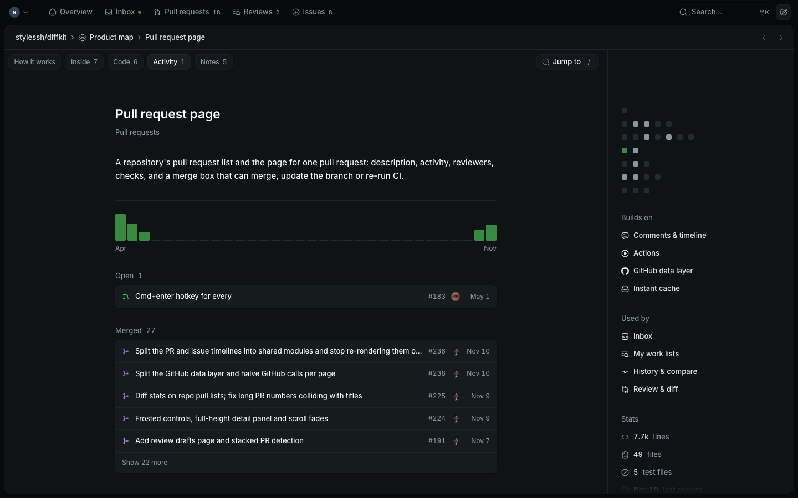
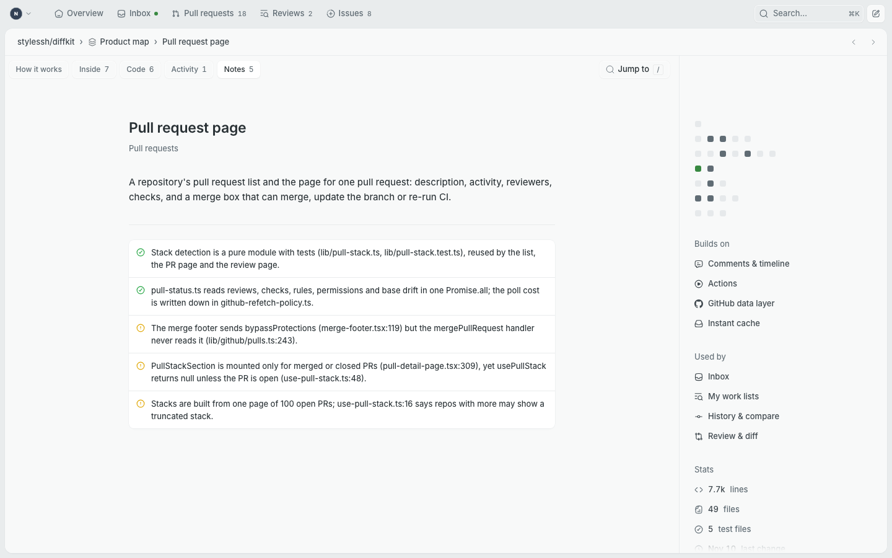

# Experiment: product map

One of five overnight takes on "a repo should be understandable as a product,
not as a file tree". This one replaces the file list with a map of the
product's areas in plain language.

Branch: `stylessh/experiment-product-map-8f81ac`. Nothing is pushed.

## Open it

```bash
pnpm install
```

```bash
pnpm dev:demo
```

Then open <http://localhost:3000/stylessh/diffkit/map>, click **Continue with
GitHub** and pick `nova`. You land back on the map.

No GitHub credentials are needed: the page renders a static data file. If
ports 3000 and 4001 are taken by another session, see the memory note
`demo-on-alternate-ports`; I ran it on 3461 and 4461.

The route sits **beside** the existing repo home, at `/$owner/$repo/map`. It
does not replace `/$owner/$repo` and is not linked from the repo tabs, because
the demo emulator has no `stylessh/diffkit` repo and the map only exists for
that one repository. Any other repo shows an empty state with a link to the
DiffKit map.

## What you are looking at



**The overview shows names and nothing else.** Seven rows of areas, 25 in
all, in the order someone meets the product: getting in, your workspace, in a
repository, pull requests, then what every screen shares, the data path, and
what surrounds the product. It uses the same layout as the repo home: a
reading column, view tabs above it, a quiet panel on the right.

Everything else is one step away:

| | |
| --- | --- |
|  |  |
| **Hover** an area: its one-line description replaces the caption under the title, wires run to what it builds on, the areas that use it stay lit, and "Talks to" marks the outside systems it touches. | **Tour**: eight stops of one or two short sentences, 7.5 s each. |
|  |  |
| **View tabs** add one number per area: commits in the last 30 days, lines, or open work. | **Jump to** (`/`) finds an area, feature, file, pull request or issue. |

**Click an area to open it.** The page follows the pull request page: title,
one or two sentences, and five tabs that show one thing at a time.

| | |
| --- | --- |
|  |  |
| **How it works**: the path one request takes. Pick a step to read its one sentence and open its file. | **Inside**: sub-features as closed rows. Opening one shows a sentence and its code references. |
|  |  |
| **Activity**: commits per week, then open and merged work. | **Notes**: what is clearly well done and what looks rough, each with its evidence. |

The fifth tab, **Code**, lists four to six symbols to start reading from.

The panel on the right holds a small dot map of the product (this area in
green, connected areas brighter; every dot is a link), then what the area
builds on, what uses it, four stats and the people who worked on it.

Moving around:

| Do | How |
| --- | --- |
| Open an area | click it |
| Back to the map | `Esc`, the breadcrumb, or browser back |
| Next or previous area | `]` and `[`, or the arrows in the header |
| Move sideways | the dot map, Builds on, Used by |
| Jump anywhere | `/` |
| Start or pause the tour | `t`; arrow keys step through it |

The area, tab and view live in the URL
(`?area=review-diff&tab=activity`), so any view can be linked.

Phone width, light and dark:
[overview dark](screenshots/overview-phone-dark.png),
[overview light](screenshots/overview-phone-light.png),
[area dark](screenshots/area-phone-dark.png),
[area light](screenshots/area-phone-light.png),
[tour](screenshots/tour-phone-light.png).
Desktop in the other theme:
[overview light](screenshots/overview-desktop-light.png),
[area dark](screenshots/area-desktop-dark.png).

## The reduction pass

The first version put everything on screen at once. Alan's feedback was that
it was cluttered, generic and showed too much, and he was right. Before:
[overview](screenshots/before/overview-desktop-dark.png),
[area page](screenshots/before/area-desktop-light.png).

What changed:

| First version | Now |
| --- | --- |
| Custom full-width page with its own tile cards | The shared `DetailLayout`, `ViewTabs`, `PanelSection`, `Chip` and list cards, as on the repo home and pull request page |
| Each tile: icon, name, a two-line description, a sparkline, sometimes a metric | Icon and name. The description appears on hover, the metric only when a view tab asks for it |
| Pitch, a three-line paragraph, a stats line, lens buttons with a description | Pitch and one caption line. Description and stats moved to the side panel |
| Ten outside systems as their own strip | Three chips in the panel (GitHub, Cloudflare, The browser) |
| Wires for "builds on", "used by" and outside systems, with badges | Wires for "builds on" only, drawn behind the areas |
| Area page: eight stacked sections, about four screens tall | Five tabs, one visible. Nothing scrolls on most tabs |
| A 25-row sidebar for moving sideways | A dot map in the panel. No left sidebar |
| Request path: six cards with a paragraph each | Six icons. One sentence for the selected step |
| Tour stops of about 30 words | About 15 words each |

The overview now fits one screen at 1440×900, which the first version did not.

## Does it answer the question?

The question: could someone who has never seen DiffKit's code understand what
the product is and how it is put together in about a minute from this page?

**What the product is: yes.** Seven labelled rows of names read in a few
seconds, and the tour explains them in one minute.

**How it is put together: partly.** The row order and tour stops 6 and 7 give
the right model: every screen goes through one data layer, a browser cache
makes it instant, webhooks become a change feed. Hovering shows what one area
depends on. The detail inside an area still takes opening it.

Where it falls short:

- **Names alone assume you know GitHub.** "History & compare" means nothing
  to someone who does not. The description is one hover away, but a first-time
  reader has to know to hover. The tour should probably start on its own on a
  first visit.
- **The good and bad parts are one click and one tab away.** Notes is the
  most valuable content per line and the overview gives no hint of where the
  rough areas are. A view tab that counts watch items per area is the obvious
  next step.
- **Dependencies are curated, not derived.** I chose the notable edges by
  hand from the analysts' notes. They should come from the import graph, with
  a model only trimming them.
- **On phones there is no hover**, so no wires and no caption: the map is a
  list of names and the area pages carry everything.
- **Links leave DiffKit.** Code and pull request links open github.com,
  because the demo emulator does not have this repo. In the real product they
  should open DiffKit's own blob, pull request and issue pages.

## What worked

- **Path rules as the definition of an area.** 113 regular expressions map
  985 of 1,001 tracked files to an area. Once that exists, size, activity,
  people and pull request attribution are exact and need no model.
- **Issues next to the code's history.** Putting open issues on the area they
  touch, beside what has shipped there, made stale ones obvious: of 8 open
  issues, #169 (asks for releases) and #185 (cannot find settings) look
  answered by #192 and #210, and #137 and #182 predate the cache rebuild.
- **The request path per area.** Four to six steps, each with a kind, a
  sentence and a file, was the format that explained "how it works" best.
- **Building on the shipped layout.** The reduced version took less code than
  the first one and reads as part of the dashboard.
- **The reading pass found real defects**, for example: the merge footer
  sends `bypassProtections` but the server handler never reads it; twelve
  files still write to a tab store nothing reads; the setup page ignores the
  error code the GitHub App callback sends it. I spot-checked ten of the
  analysts' claims against the code and all held.
- **Mechanical checking of code references.** The build fails on a missing
  path and re-anchors a line number when the symbol has moved.

## What did not work

- **The first version**, for the reasons above.
- **A shared-element morph from tile to page.** I dropped it for a camera
  push toward the clicked area, which is simpler.
- **Square-root scaling for the view tints.** It flattened every area to the
  same tint. Linear scaling shows the differences.
- **Not done:** the check on a second, well-known repository. Time went to
  accuracy and then to the reduction pass, so whether the idea is overfitted
  to DiffKit is untested.

## References that shaped it

Interaction ideas only; no design, assets or copy were taken.

- [Creative Reference Library](https://crl-2026.webflow.io/library): one
  item holds the screen in large type, its neighbours stay faint, and a
  Wheel/List switch re-lays the same items. It became the single caption
  line that names whatever you point at, and the idea that the overview and
  the dot map are the same items in two layouts.
- [DeepBook](https://www.deepbook.tech/): numbered layers stacked like
  folder tabs, one line each, with text that sharpens as you reach it. It
  became the rows-as-layers order of the map and the one-sentence rule.
- [FORMAT](https://format.obys.agency/) and
  [Grids](https://grids03.obys.agency/), both by Obys: a single dial changes
  the format of the same content, and composition is carried by blocks, not
  text. They became the view tabs that recolour the same map, and the dot
  map. Grids would not run at the browser pane's width, so I only saw its
  opening composition.
- [incident.io Catalog Graph](https://mobbin.com/screens/dd2f6452-c35e-42f0-b179-d3f1fa9ef9b3)
  and the
  [Quo call flow builder](https://mobbin.com/screens/160b7a9c-6331-4e2d-a59a-5567fe521f58),
  through Mobbin: relationship lines between typed nodes, and a selected step
  with its details beside it. They became the wires and the request path.

A fifth winner, Cyera AI Guardian, stayed on its loading screen in the
built-in browser, so I could not use it. The first inspiration pass, before
Alan's correction, only read the Awwwards listing pages; the second used the
live sites for about 15 minutes.

## How the data was produced

Everything is in [`pipeline/`](pipeline). The output is
`apps/dashboard/src/components/product-map/data/diffkit.json` (320 KB).

| File | What it is | Made by |
| --- | --- | --- |
| `area-paths.json` | 113 path rules, first match wins | me, from the folder layout and the analysts' corrections |
| `areas.json` | bands, tour, and per area: summary, how it works, request path, features, entry points, good parts, watch items | four agents reading the code, then edited by me |
| `issue-areas.json` | 16 issues mapped to areas, with a note where one looks answered | me, by judgment |
| `github-snapshot.json` | pull request and issue metadata, fetched 12 Nov 2026 | read-only `gh` |
| `build.mjs` | joins the above with `git log` and checks every code reference | script, no model |

To rebuild after editing any of them:

```bash
node docs/experiments/product-map/pipeline/build.mjs
```

Steps, in order:

1. **Taxonomy.** I listed routes, component folders, `lib`, packages and docs,
   and proposed 25 areas.
2. **Reading.** Four agents each took 4 to 7 areas with one brief: describe
   only what you opened, verify every path and line, plain language. They
   used about 1.43 M tokens and 259 tool calls in total, roughly 11 minutes
   each in parallel. Their notes also corrected the taxonomy in several places
   (for example, the my-work search modules feed the lists, not the command
   palette).
3. **History.** `build.mjs` reads `git log --name-only` for 217 commits,
   applies the path rules, and derives per area: files, lines, test files,
   commits per week, commits in the last 30 days, people, most-changed files.
4. **Pull requests.** A squash commit ending in `(#123)` ties a pull request
   to its files with no API call (151 of 202). The other 51, and the 4 open
   ones, needed their file lists from GitHub. A pull request belongs to its
   top area and to any area holding at least 20% of its changed files.
5. **Checks.** Every referenced path must exist. Every `line` must hold its
   `symbol`; if not, the script finds the symbol and corrects the line, or
   reports it. Every area id used anywhere must exist.

GitHub calls made tonight, all read-only: one pull request list, one issue
list, and 55 `gh pr view --json files`.

Known gaps in the data: the snapshot is frozen at commit `312aece`
(`snapshotCommit` in `areas.json`; change or remove it to analyse a newer
history); closed
unmerged pull requests are ignored; a pull request merged without a squash
suffix is counted from GitHub's file list, which caps at 100 files.

## What a real pipeline would need

**Inputs:** the repository at a commit, `git log` with file names, pull
requests with their changed files, issues with title and body, and the
previous map.

**No model needed** (run on every push to the default branch, seconds):
applying path rules, sizes, weekly activity, people, pull request
attribution, reference checking and line re-anchoring.

**Model needed:**

- proposing the taxonomy and the path rules for a new repository, and
  proposing changes when files stop matching any rule;
- the prose per area: summary, how it works, request path, features, entry
  points;
- the judgment notes (good parts, watch items), which need the code read, not
  summarised from file names;
- mapping an issue to areas from its title and body, and noticing when
  shipped work has answered it;
- the tour script.

**Keeping it cheap:** only re-read an area when enough of its files changed
since its description was written. A merged pull request touches one to three
areas, so the steady-state cost is a few area re-reads per pull request, about
60 k to 100 k input tokens each at tonight's rate, not a full 1.4 M token
pass. The descriptions should also be reviewed like code: store `areas.json`
in the repository, and let the model open a pull request against it.

**GitHub cost:** a first build needs the pull request list with files. Over
GraphQL that is about one request per 50 pull requests (`files(first: 100)`
nested under `pullRequests(first: 50)`), so 5 requests for this repository,
plus one or two for issues. After that, the existing webhook feed already
says when a pull request merges or an issue changes, so each update is one
request. Squash-merged pull requests need none.

**Would also need:** edges from the import graph instead of by hand, a way
for the owner to correct a description and have the correction survive the
next regeneration, and in-app links.

## Code

- Route: `apps/dashboard/src/routes/_protected/$owner/$repo/map.tsx`
- Components: `apps/dashboard/src/components/product-map/`
  - `product-map-page.tsx`: page, URL state, keys, the zoom between map and area
  - `map-canvas.tsx`, `map-wires.tsx`, `spotlight.ts`: areas, wires, what is lit
  - `map-panel.tsx`: the overview's side panel
  - `area-sheet.tsx`, `area-activity.tsx`, `area-panel.tsx`: the area page, its tabs and side panel
  - `map-search.tsx`, `map-tour.tsx`: jump-to and the tour
- It uses `packages/ui` components and the existing theme tokens only. No new
  dependency, no change to `packages/ui`.

`pnpm check` and `pnpm check-types` pass. There is one unit test, for the
tour's state transitions. No e2e test was added; I verified by driving the
page with Playwright against the demo emulator (open an area, the five tabs,
`[` `]`, `Esc`, browser back, the panel links, search, tour auto-advance, view
tabs, wires, the empty state) and by reading the screenshots in both themes at
1440×900 and 390×844, beside screenshots of the shipped repo home and pull
request page.
