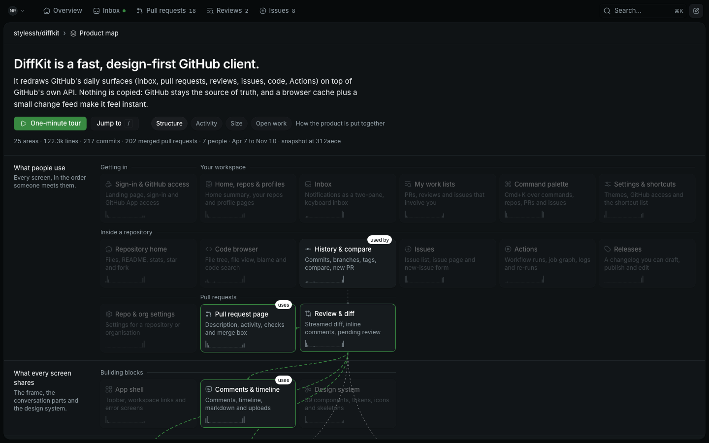

# Experiment: product map

One of five overnight takes on "a repo should be understandable as a product,
not as a file tree". This one replaces the file list with a map of the
product's areas in plain language.

Branch: `stylessh/experiment-product-map-8f81ac`. Nothing is pushed.

## Open it

```bash
pnpm install
```

```bash
pnpm dev:demo
```

Then open <http://localhost:3000/stylessh/diffkit/map>, click **Continue with
GitHub** and pick `nova`. You land back on the map.

No GitHub credentials are needed: the page renders a static data file. If
ports 3000 and 4001 are taken by another session, see the memory note
`demo-on-alternate-ports`; I ran it on 3461 and 4461.

The route sits **beside** the existing repo home, at `/$owner/$repo/map`. It
does not replace `/$owner/$repo` and is not linked from the repo tabs, because
the demo emulator has no `stylessh/diffkit` repo and the map only exists for
that one repository. Any other repo shows an empty state with a link to the
DiffKit map.

## What you are looking at


**The overview is a cross-section of the product.** Four bands, top to bottom:
what people use (every screen, in the order someone meets them), what every
screen shares, what makes it fast (the data path), and what surrounds it. A
last strip names the systems DiffKit talks to but does not own (GitHub,
Cloudflare, the browser). 25 areas in all, each a tile with a name, one plain
line, and a sparkline of weekly commits since the first commit.

| | |
| --- | --- |
|  |  |
| Hover a tile: solid wires run to what it builds on, dotted wires come from what uses it, and the outside systems it touches light up. | The one-minute tour: eight stops, 7.5 s each, lighting the tiles it talks about. |
|  |  |
| Click a tile to dive in. The map becomes a rail on the left for moving sideways. | Lower on the same page: entry points, weekly activity, open and merged work, people. |

Each area page answers, in this order:

1. **What it does for a user**, in one or two sentences.
2. **How it works**: a short paragraph, then the path one request takes
   through it (page, browser state, server function, API route, GitHub,
   storage). A highlight travels along the steps; hover holds it.
3. **What is inside**: sub-features, each with one to three code references.
4. **Ways into the code**: four to six symbols to start reading from, with
   `path:line`. They open on GitHub.
5. **What is happening here**: commits per week, open pull requests and
   issues, merged pull requests.
6. **Who has worked on it**.
7. **Connected to**: builds on, used by. Click to move sideways.
8. **Worth knowing**: what is clearly well done and what looks rough, each
   with its evidence.

Moving around:

| Do | How |
| --- | --- |
| Open an area | click a tile |
| Back to the map | `Esc`, the breadcrumb, or browser back |
| Next or previous area | `]` and `[`, or the arrows in the header |
| Jump to an area, feature, file, pull request or issue | `/` |
| Start, pause the tour | `t`; arrow keys step through it |
| Recolour the map | Structure, Activity, Size, Open work |

The area and the lens live in the URL (`?area=review-diff&lens=activity`), so
any view can be linked.

More screenshots, light and dark, desktop and phone:
[overview light](screenshots/overview-desktop-light.png),
[overview phone dark](screenshots/overview-phone-dark.png),
[overview phone light](screenshots/overview-phone-light.png),
[activity lens](screenshots/activity-desktop-light.png),
[area dark](screenshots/area-desktop-dark.png),
[area phone dark](screenshots/area-phone-dark.png),
[area phone light](screenshots/area-phone-light.png),
[tour on a phone](screenshots/tour-phone-light.png),
[search](screenshots/search-desktop-light.png).

## Does it answer the question?

The question: could someone who has never seen DiffKit's code understand what
the product is and how it is put together in about a minute from this page?

**What the product is: yes.** The pitch, the first band and the tour do it.
The tour is eight stops of about 30 words, 60 seconds in total, and it is the
part I would keep whatever else changes.

**How it is put together: partly.** The band order (screens, shared parts,
data path, outside systems) and tour stops 6 and 7 give the right mental
model: every screen goes through one data layer, a browser cache makes it
instant, webhooks become a change feed. The wires add "this screen depends on
those parts". What a newcomer does not get in a minute is the detail inside an
area. That takes opening it, and each area page is a few minutes of reading.

Where it falls short:

- **25 tiles is a lot to scan cold.** Without the tour a first-time reader
  spends the minute reading tiles. The tour should probably start on its own
  on a first visit.
- **The map does not fit one screen at 1440×900.** The first two bands do. The
  data path, which is the most interesting part, starts below the fold.
- **The good and bad parts are buried.** "Worth knowing" sits at the bottom of
  each area. It is the most valuable content on the page per line, and the
  overview gives no hint of where it is. A lens for it is the obvious next
  step.
- **Wires get busy for hub areas.** Hovering the GitHub data layer draws 23 of
  them across the tiles.
- **Dependencies are curated, not derived.** I chose the notable edges by
  hand from the analysts' notes. They should come from the import graph, with
  a model only trimming them.
- **An area page is a document.** Summary and request path work as a glance;
  everything below is reference.
- **On phones there are no wires.** The map works as a list and the area
  pages work well, but the "how it connects" interaction is desktop only.
- **Links leave DiffKit.** Code and pull request links open github.com,
  because the demo emulator does not have this repo. In the real product they
  should open DiffKit's own blob, pull request and issue pages.

## What worked

- **Path rules as the definition of an area.** 113 regular expressions map
  985 of 1,001 tracked files to an area. Once that exists, size, activity,
  people and pull request attribution are exact and need no model.
- **Issues next to the code's history.** Putting open issues on the area they
  touch, beside what has shipped there, made stale ones obvious: of 8 open
  issues, #169 (asks for releases) and #185 (cannot find settings) look
  answered by #192 and #210, and #137 and #182 predate the cache rebuild.
- **The request path per area.** Four to six steps, each with a kind, a
  sentence and a file, was the format that explained "how it works" best.
- **The reading pass found real defects**, for example: the merge footer
  sends `bypassProtections` but the server handler never reads it; twelve
  files still write to a tab store nothing reads; the setup page ignores the
  error code the GitHub App callback sends it. I spot-checked ten of the
  analysts' claims against the code and all held.
- **Mechanical checking of code references.** The build fails on a missing
  path and re-anchors a line number when the symbol has moved.

## What did not work

- **The first layout.** Each group of tiles was its own cluster; one group of
  seven wasted a row. A single grid per band with group labels on a rail above
  the tiles is denser and reads better.
- **A shared-element morph from tile to page.** I dropped it for a camera
  push toward the clicked tile, which is simpler and holds up when the page
  has scrolled.
- **Square-root scaling for the lenses.** It flattened every tile to the same
  tint. Linear scaling shows the differences.
- **Inspiration from Awwwards.** The Sites of the Day are mostly video case
  studies; I got the names of interactions from them, not much more.
- **Not done:** the check on a second, well-known repository. Time went to
  accuracy on this one, so whether the idea is overfitted to DiffKit is
  untested.

## References that shaped it

Interaction ideas only; no design, assets or copy were taken.

- [incident.io Catalog Graph](https://mobbin.com/screens/dd2f6452-c35e-42f0-b179-d3f1fa9ef9b3)
  (Mobbin): typed nodes, relationship lines and "expand a level deeper". It
  became the wires and the drill from product to area to feature to code.
- [Quo call flow builder](https://mobbin.com/screens/160b7a9c-6331-4e2d-a59a-5567fe521f58)
  (Mobbin): a selected step with an inspector that offers "jump to" the next
  one. It became the request path and the sideways jumps.
- Creative Reference Library, Awwwards Site of the Day for 10 Nov 2026: its
  list-to-carousel transition keeps the same items and changes their layout.
  It became the dive from the map into an area, with the map staying on as a
  rail.

The tour's segmented progress bar is the stories pattern, from my own
knowledge. About 15 minutes went to inspiration, of the 30 allowed.

## How the data was produced

Everything is in [`pipeline/`](pipeline). The output is
`apps/dashboard/src/components/product-map/data/diffkit.json` (320 KB).

| File | What it is | Made by |
| --- | --- | --- |
| `area-paths.json` | 113 path rules, first match wins | me, from the folder layout and the analysts' corrections |
| `areas.json` | bands, tour, and per area: summary, how it works, request path, features, entry points, good parts, watch items | four agents reading the code, then edited by me |
| `issue-areas.json` | 16 issues mapped to areas, with a note where one looks answered | me, by judgment |
| `github-snapshot.json` | pull request and issue metadata, fetched 12 Nov 2026 | read-only `gh` |
| `build.mjs` | joins the above with `git log` and checks every code reference | script, no model |

To rebuild after editing any of them:

```bash
node docs/experiments/product-map/pipeline/build.mjs
```

Steps, in order:

1. **Taxonomy.** I listed routes, component folders, `lib`, packages and docs,
   and proposed 25 areas.
2. **Reading.** Four agents each took 4 to 7 areas with one brief: describe
   only what you opened, verify every path and line, plain language. They
   used about 1.43 M tokens and 259 tool calls in total, roughly 11 minutes
   each in parallel. Their notes also corrected the taxonomy in several places
   (for example, the my-work search modules feed the lists, not the command
   palette).
3. **History.** `build.mjs` reads `git log --name-only` for 217 commits,
   applies the path rules, and derives per area: files, lines, test files,
   commits per week, commits in the last 30 days, people, most-changed files.
4. **Pull requests.** A squash commit ending in `(#123)` ties a pull request
   to its files with no API call (151 of 202). The other 51, and the 4 open
   ones, needed their file lists from GitHub. A pull request belongs to its
   top area and to any area holding at least 20% of its changed files.
5. **Checks.** Every referenced path must exist. Every `line` must hold its
   `symbol`; if not, the script finds the symbol and corrects the line, or
   reports it. Every area id used anywhere must exist.

GitHub calls made tonight, all read-only: one pull request list, one issue
list, and 55 `gh pr view --json files`.

Known gaps in the data: the snapshot is frozen at commit `312aece`
(`snapshotCommit` in `areas.json`; change or remove it to analyse a newer
history); closed
unmerged pull requests are ignored; a pull request merged without a squash
suffix is counted from GitHub's file list, which caps at 100 files.

## What a real pipeline would need

**Inputs:** the repository at a commit, `git log` with file names, pull
requests with their changed files, issues with title and body, and the
previous map.

**No model needed** (run on every push to the default branch, seconds):
applying path rules, sizes, weekly activity, people, pull request
attribution, reference checking and line re-anchoring.

**Model needed:**

- proposing the taxonomy and the path rules for a new repository, and
  proposing changes when files stop matching any rule;
- the prose per area: summary, how it works, request path, features, entry
  points;
- the judgment notes (good parts, watch items), which need the code read, not
  summarised from file names;
- mapping an issue to areas from its title and body, and noticing when
  shipped work has answered it;
- the tour script.

**Keeping it cheap:** only re-read an area when enough of its files changed
since its description was written. A merged pull request touches one to three
areas, so the steady-state cost is a few area re-reads per pull request, about
60 k to 100 k input tokens each at tonight's rate, not a full 1.4 M token
pass. The descriptions should also be reviewed like code: store `areas.json`
in the repository, and let the model open a pull request against it.

**GitHub cost:** a first build needs the pull request list with files. Over
GraphQL that is about one request per 50 pull requests (`files(first: 100)`
nested under `pullRequests(first: 50)`), so 5 requests for this repository,
plus one or two for issues. After that, the existing webhook feed already
says when a pull request merges or an issue changes, so each update is one
request. Squash-merged pull requests need none.

**Would also need:** edges from the import graph instead of by hand, a way
for the owner to correct a description and have the correction survive the
next regeneration, and in-app links.

## Code

- Route: `apps/dashboard/src/routes/_protected/$owner/$repo/map.tsx`
- Components: `apps/dashboard/src/components/product-map/`
  - `product-map-page.tsx`: page, URL state, keys, the zoom between map and area
  - `map-canvas.tsx`, `map-wires.tsx`, `spotlight.ts`: tiles, bands, wires, what is lit
  - `area-sheet.tsx`, `area-activity.tsx`: the area page
  - `map-rail.tsx`, `map-search.tsx`, `map-tour.tsx`: sideways rail, jump-to, tour
- It uses `packages/ui` components and the existing theme tokens only. No new
  dependency.

`pnpm check` and `pnpm check-types` pass. There is one unit test, for the
tour's state transitions. No e2e test was added; I verified by driving the
page with Playwright against the demo emulator (tile click, `[` `]`, `Esc`,
browser back, search, tour auto-advance, lenses, wires, the empty state) and
by reading the screenshots in both themes at 1440×900 and 390×844.
