# @diffkit/ui

Shared UI kit for DiffKit: shadcn (new-york) on Radix + Tailwind 4, styled after Linear.
Primitives only — no GitHub-specific logic lives here.

```ts
import { Button } from "@diffkit/ui/components/button";
import { cn } from "@diffkit/ui/lib/utils";
import { EmptyInboxIllustration } from "@diffkit/ui/illustrations";
import "@diffkit/ui/globals.css"; // once, in the app's stylesheet
```

Exports: `./components/*`, `./lib/*`, `./hooks/*`, `./illustrations[/*]`, `./globals.css`.
Components are client components; icons come from `@diffkit/icons`.

Scripts: `pnpm --filter @diffkit/ui test | check-types | lint`.

## Design tokens

The look is Linear's: minimal, neutral grays, **0.5px hairline rings instead of 1px borders**,
**two-layer low-alpha drop shadows**, small radii, a tight type scale (13px is the working size),
and a main pane that floats as an inset card over a slightly darker shell. Values are measured
from Linear's live app and live in `src/styles/globals.css` in three layers:

1. **`--ln-*`** — raw Linear values, light in `:root`, dark in `.dark` (toggle with `next-themes`).
2. **shadcn variables** (`--background`, `--card`, `--popover`, `--border`, `--ring`, `--muted`,
   `--sidebar`, `--surface-0..3`, …) — aliased onto layer 1, declared for both `:root` and `.dark`.
   Every existing name still works; only the values moved. `--radius` is `0.5rem`
   (sm 4 / md 6 / lg 8 / xl 12).
3. **`@theme`** — Tailwind utilities for layer 1, so app code never touches `--ln-*` directly.

### Using them

| Need | Use |
| --- | --- |
| App chrome behind the content (sidebar, header strip) | `bg-shell` |
| The main content pane, as an inset card | `bg-main shadow-main rounded-xl` inside a `bg-shell p-2` wrapper (`<SidebarInset>` with `variant="inset"` already does this) |
| Card / comment card | `bg-card shadow-card rounded-lg` |
| Raised pill (toolbar button, tab, select trigger) | `bg-button shadow-button hover:bg-button-hover` |
| Selected pill (active tab) | `bg-tab-selected shadow-tab-selected` |
| Menus, popovers, dialogs, tooltips | `bg-popover shadow-popover rounded-xl` (`bg-dialog`, `bg-tooltip` for those) |
| Hairline around a field / chip / key | `shadow-field`, `shadow-chip`, `shadow-key`, `shadow-ring` |
| Hairline divider | `border-b-[0.5px] border-rule` (or `<Separator />`) |
| Ghost hover, menu row hover, list row hover / selected | `hover:bg-ghost-hover`, `focus:bg-menu-hover`, `hover:bg-row-hover`, `bg-row-selected` |
| Text steps | `text-foreground` › `text-text-strong` › `text-text-header` › `text-muted-foreground` › `text-icon-faint` |
| Status colors | `text-success`, `text-warning`, `text-merged`, `text-danger`, `text-added`, `text-removed`, `bg-pill-ok`, `bg-pill-blocked`, `bg-pill-neutral` |
| The one saturated action | `bg-indigo text-indigo-foreground` (`<Button variant="accent">`) |
| GitHub state of a PR / issue (icon) | `text-state-open`, `text-state-draft`, `text-state-merged`, `text-state-closed` |
| CI check conclusion (icon, dot) | `text-check-passed`, `text-check-running`, `text-check-failed`, `text-check-skipped` (and `bg-*`) |
| Review verdict | `text-review-approved`, `text-review-changes`, `text-review-required` (and `bg-*`) |
| Tinted state pill | `bg-pill-ok text-pill-ok-text`, `bg-pill-merged text-pill-merged-text`, `bg-pill-blocked text-pill-blocked-text`, `bg-pill-warning text-pill-warning-text`, `bg-pill-neutral text-muted-foreground` (`<StatePill tone>` / `<Badge variant>` use these) |
| Row metadata chip (repo, label, branch) | `<Chip>`: `h-6 rounded-full bg-chip shadow-chip text-xs text-muted-foreground` |
| Diff line tints | `bg-line-added`, `bg-line-removed`, `bg-word-added`, `bg-word-removed`, `text-line-number`; `@pierre/diffs` picks them up through its `--diffs-*-override` variables |
| Top nav / tab items on the shell | `text-text-nav hover:bg-nav-hover [&.active]:bg-nav-selected` |
| Tooltip surface | `bg-tooltip shadow-tooltip` |
| Focus | `outline-focus` / the base `:focus-visible` rule (1px `--ln-focus`, offset -1px) |

Motion: hover, selection and popover transitions share `--ln-duration` (140ms) and `--ln-ease`
(`ease-ln`); `prefers-reduced-motion` collapses every animation and transition. Menus use 28px rows
with 6px radii inside a 10px popover with 4px padding, so the corners stay concentric.

Rules of thumb: never add `border` + `shadow-sm`; use a ring token. Bare `border` utilities are
written `border-[0.5px]` so they match the rings (Chrome rounds them to one device pixel on 1x
screens). Never use raw Tailwind hues (`text-green-500`, `bg-yellow-400`) for state; use the state
tokens above. Focus is a 1px indigo outline
(`focus-visible:outline-1 focus-visible:-outline-offset-1 focus-visible:outline-ring`), not a glow.
Keep corners ≤ 12px except fully-round pills and avatars.

Existing `bg-surface-0/1/2`, `bg-container`, `text-destructive-foreground`, etc. keep working and
resolve to the Linear set (card → group fill → selected nav). New code should prefer the semantic
names above; `apps/dashboard` will migrate in a later pass.

## Components

**Primitives (restyled to the Linear look):** `alert`, `alert-dialog`, `avatar`, `badge`, `breadcrumb`,
`button`, `calendar`, `callout`, `card`, `checkbox`, `collapsible`, `command`, `context-menu`,
`dialog`, `drawer`, `dropdown-menu`, `form`, `hover-card`, `input`, `label`, `popover`, `progress`,
`resizable`, `select`, `separator`, `sheet`, `sidebar`, `skeleton`, `sonner`, `spinner`,
`state-pill`, `switch`, `table`, `tabs`, `textarea`, `toggle`, `tooltip`.

**Added in this port:** `accordion`, `activity-log`, `attachment`, `bubble`, `check-state-icon`,
`diff-view-options`, `empty-state`, `field`, `file-search-card`, `fluid-surface` (elevation levels
mapped to shell → main → card → raised → overlay), `horizontal-scroll-fade`, `hover-card`,
`input-group`, `item`, `keyboard-shortcut-keys`, `marker`, `message`, `message-scroller`,
`navigation-menu`, `overlay-scroll-area`, `pagination`, `panel-state`, `provider-logo`,
`repository-media-player`, `safe-polygon-debug-overlay`, `section-card`, `segmented-toggle`,
`slider`, `tab-strip`, `text-effect`, `svgs/*` (brand marks), `markdown-editor-upload` (helpers).

**Variants worth knowing**

- `Button`: `default | accent | destructive | success | purple | gold | outline | pill | secondary | subtle | ghost | link`;
  sizes `default | xxs | xs | sm | lg | icon | icon-sm`. `asChild` + `disabled` makes a slotted link inert.
- `Badge`: `default | secondary | destructive | outline | success | warning | purple | gold`; `size="sm|default|lg"`,
  `icon`, `onRemove` (removable chip), or `onClick` + `pressed` (toggle chip).
- `Input`: `unstyled` strips chrome for use inside popover search rows.
- `Dialog`: `showCloseButton`, `defaultOpen`, `DialogBody`.
- `TooltipContent`: `keys={["⌘", "K"]}` draws hairline key boxes. `CommandShortcut`/`DropdownMenuShortcut` take `keys` too.
- `Slider` (Radix): `value`/`defaultValue` are one-element arrays.

## Markdown

`<Markdown>` (`components/markdown`) is `remark-gfm` → `rehype-raw` → **`rehype-sanitize`** (GitHub-style
allow-list plus `iframe[src]`, `video`, GFM alerts), so raw HTML in READMEs and comments is safe to render.

| Feature | Prop / helper |
| --- | --- |
| GitHub alerts (`> [!NOTE]`) with icons | on by default (`lib/rehype-alert-icons` re-attaches the icon after sanitizing) |
| `@mentions` → links or a custom component | `resolveMentionHref`, `mentionComponent` |
| `#123` references in the current repo | `resolveRepoNumberReference(number) => ResourceReference \| null`, `referenceComponent` |
| Pasted GitHub URLs → rich references (user, repo, PR, issue, release) | `resolveReference(url) => ResourceReference \| null` |
| Relative image/video/`srcset` rewriting | `resolveAssetUrl`; links: `resolveLinkUrl`; `imageComponent` for lightboxes |
| Router-aware internal links | `internalLinkComponent` |
| Extra remark plugins (run before the sanitizer) | `remarkPlugins` |
| Highlighted code with copy button, hydration-safe, bounded LRU cache | `ShikiCode`, `PlainCodeBlock`, `highlightCode`, `MarkdownCodeBlockContext` |

Retheme in one place: `lib/markdown-theme.ts`. Plugins: `lib/remark-profile-mentions`,
`lib/remark-repo-number-references`, `lib/remark-resource-references`; schema: `lib/markdown-sanitize-schema`.
`MarkdownEditor` keeps its textarea-based API; upload placeholders live in `components/markdown-editor-upload`.

## Lib & hooks

`fuzzy-file-search` (`searchFiles`, `getMatchIndices`), `safe-polygon` + `hooks/use-safe-polygon` (hover-intent
submenus; `safe-polygon-debug-overlay` visualises it), `keyboard-shortcut-keys`, `editable-keyboard-target`,
`horizontal-scroll-fade-insets` + `hooks/use-horizontal-scroll-fades`, `diff-count-colors`,
`segmented-control-classes`, `lifted-overlay-surface` (shared overlay recipes), `apple-touch-device`,
`input-autofocus`.

## Illustrations

`@diffkit/ui/illustrations` — empty-state art with light/dark variants:
`Empty{Inbox,Issues,PullRequests,Reviews,Bots,CliKeys,GpgKeys,SshKeys,Webhooks}Illustration`,
`InboxSelectNotificationIllustration`. Pair with `EmptyState`.

## Not ported (and why)

- `agent-harness-picker`, `model-picker`, `prompt-composer*` — AI/agent specific.
- `markdown-editor-context` — only works with a CodeMirror editor; ours is a textarea.
- `flow-icons` — file-type icons served from another product's CDN; `FileSearchCard` takes `renderIcon` instead.
- Upstream bumps that need major dependency upgrades or change defaults the dashboard relies on:
  `react-day-picker@10`, `react-resizable-panels@4` (`panel-group-cookie-storage`), Tabs `activationMode="manual"`,
  the touch-first `useIsMobile`, tooltip without its own provider.

## Screenshots

Before (previous kit) → after (Linear tokens + restyled primitives). Light and dark.

| | Before | After |
| --- | --- | --- |
| Primitives, light | 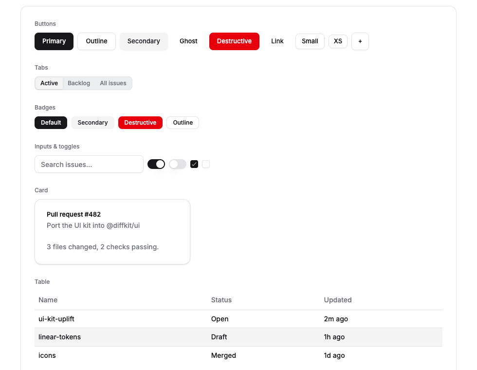 | 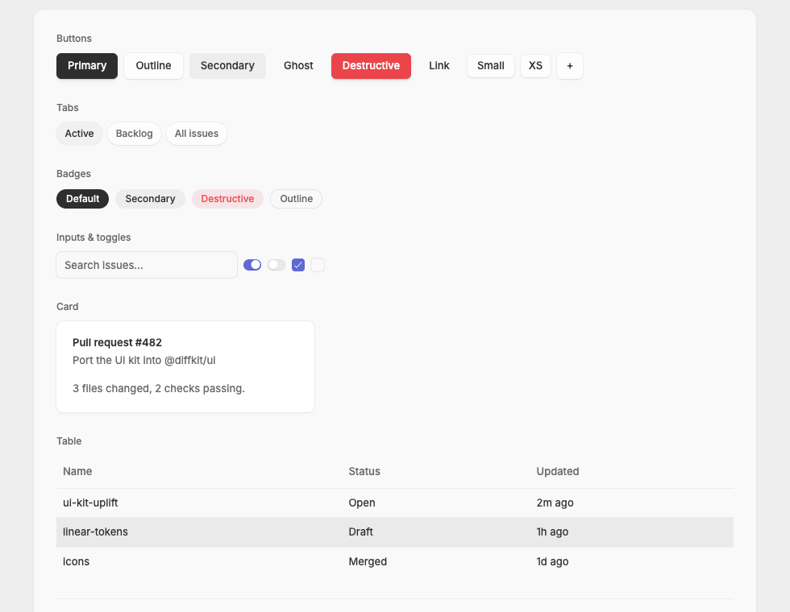 |
| Primitives, dark | 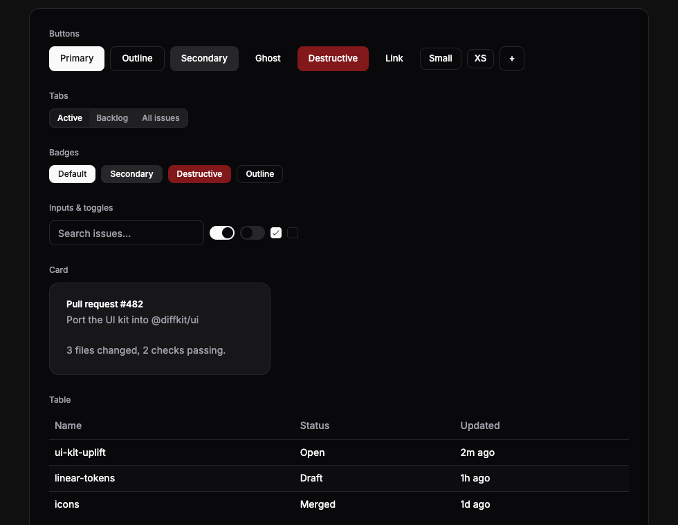 | 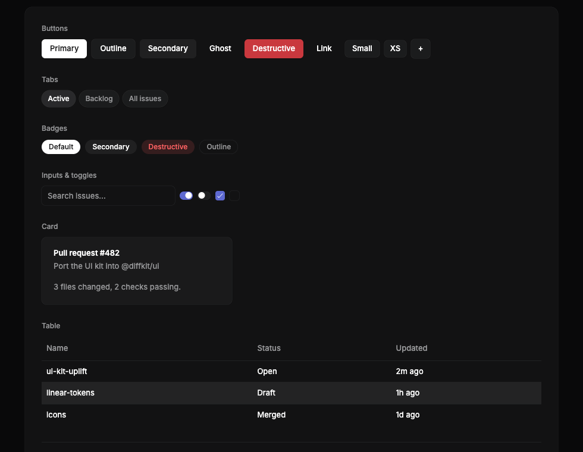 |
| Menu + tooltip, light | 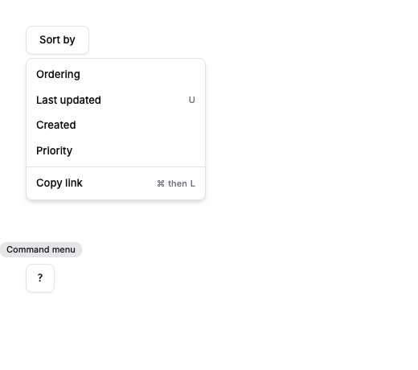 | 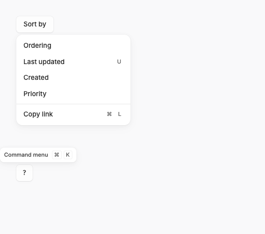 |
| Menu + tooltip, dark | 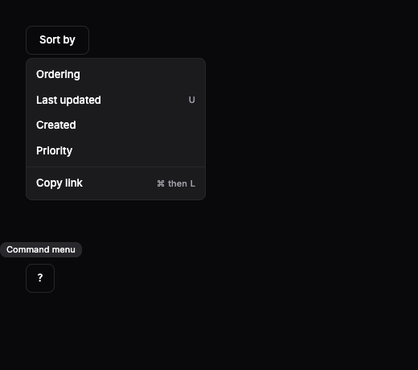 | 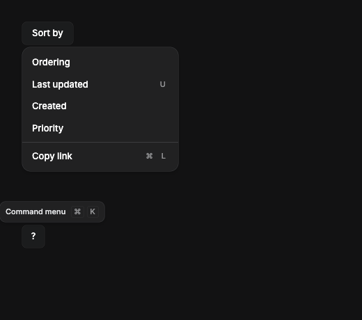 |
| Dialog, light | 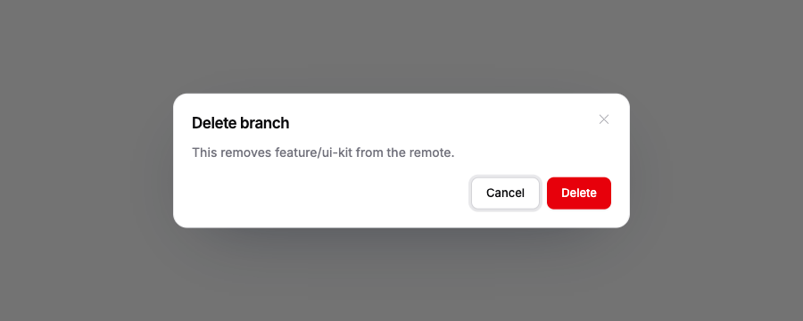 | 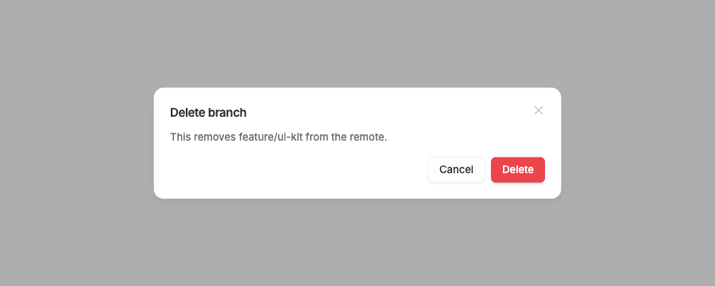 |
| Dialog, dark | 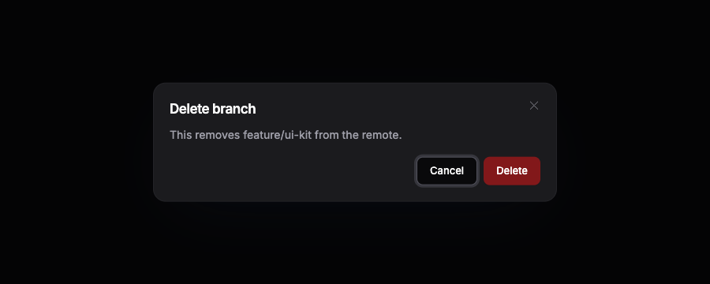 | 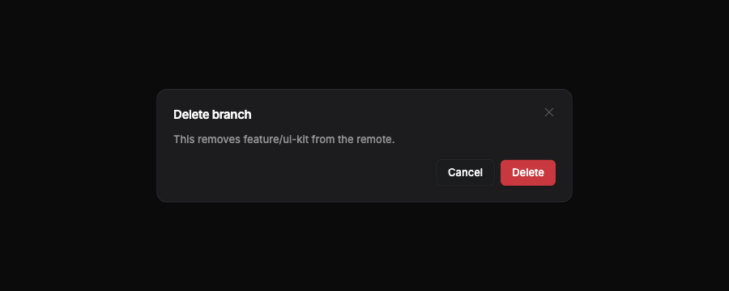 |
| Added components, light | — | 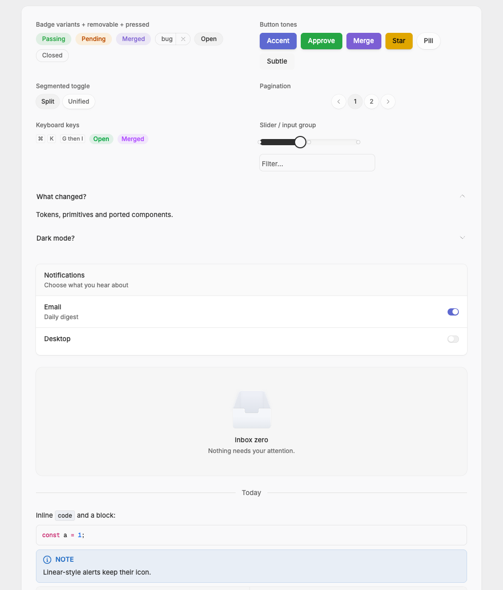 |
| Added components, dark | — | 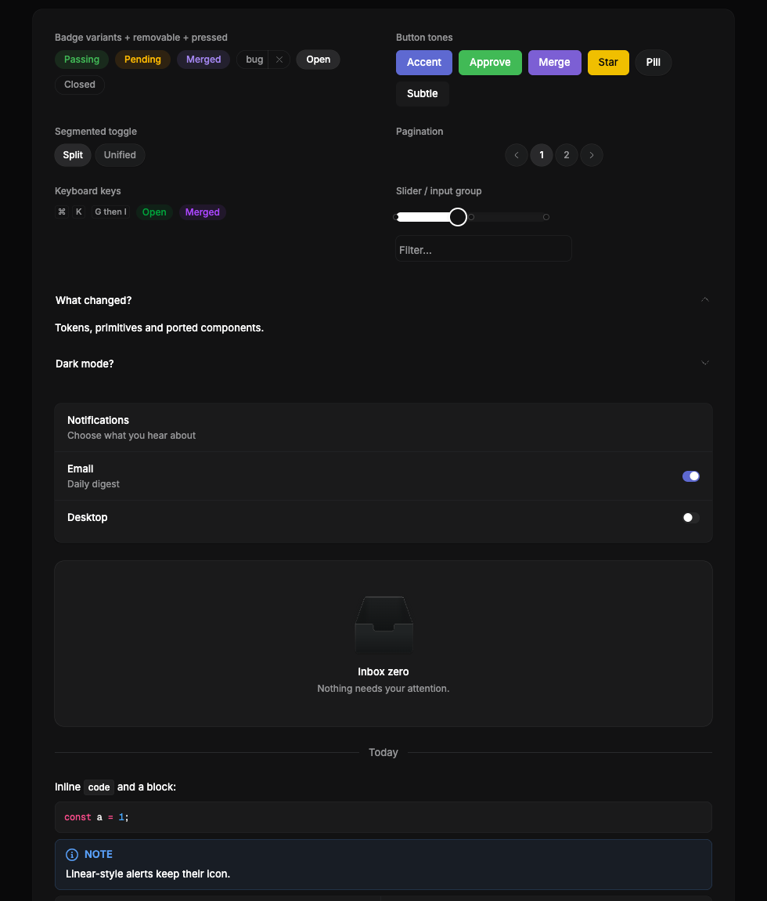 |
